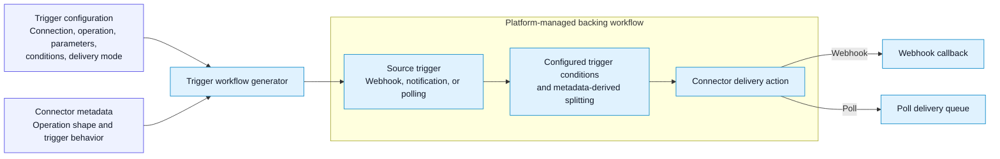
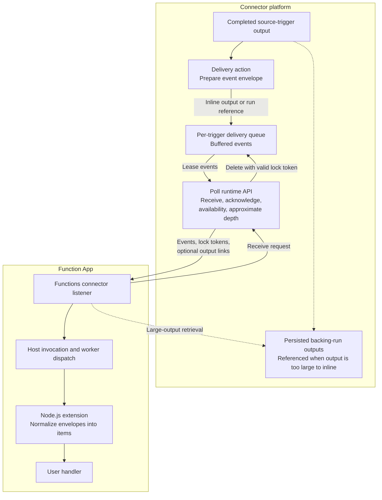

# Inside the architecture: How connectors work with Azure Functions

> Working draft. Confirm release status and approval to publish backend implementation details before publishing. The source references and publication checklist at the end are author notes, not part of the finished post.

Connecting an application to an external service takes more than an HTTP request. The application needs an authorized connection, a way to detect changes, a delivery mechanism, and code that processes those changes.

Our connector integration with Azure Functions separates these responsibilities. The connector platform manages connectivity and source-trigger execution. Azure Functions hosts and invokes application code. The Node.js SDK and Functions extension give developers typed APIs for calling actions and handling events.

This separation lets developers use managed connectors from code without rebuilding each service integration. To understand how, we need to follow both directions through the architecture: an application calling an external service, and an external event invoking an application.

## 1. What are the main architectural layers?

The architecture has a configuration layer and two runtime paths.

The configuration layer contains the Connector Namespace, connections, access policies, and trigger configurations. These define which service to connect to, who may use the connection, and which events the platform should deliver.

The action path starts with application code and ends with an external service operation. The event path starts with a change in an external service and ends with a function invocation.

Solid arrows show runtime flow. Dotted arrows show configuration dependencies, not event delivery. The host, extension, and handler boxes describe layers within the application, not separate deployed services.

The generated SDK is not a second implementation of every SaaS integration. It provides the programming interface, while the managed connector runtime performs the service integration. Likewise, the Functions trigger helper does not implement a remote subscription protocol. It registers a handler with the host and makes delivered events easier to consume.

## 2. Why separate configuration from runtime execution?

Creating a connection and using a connection are different operations.

The management path defines:

- The connector and external account or service.
- The authorization required by that external service.
- The application identities allowed to access the connection.
- The trigger operation and its source parameters.
- The event-delivery mode.

The runtime path uses that configuration to call an action or deliver an event.

This keeps resource setup out of the function handler. An email handler should not recreate an Outlook connection or establish a new source subscription on each invocation. It should process the event.

The sample deployment follows this separation. Infrastructure provisioning creates resources such as the Function App, Connector Namespace, and access policies. Deployment hooks complete connector authorization and trigger setup. The function processes events after those steps succeed.

The distinction also helps with troubleshooting. A connection that needs consent, a disabled trigger configuration, and an exception in application code are different failures. Each belongs to a different layer.

## 3. How does an action call reach the external service?

On the action path, developers use a generated connector client.

The client exposes operation-specific methods and models derived from connector metadata. Shared SDK components handle the common work beneath those methods: constructing requests, acquiring bearer tokens through `TokenCredential`, applying HTTP policies, and exposing errors and tracing information.

For the Connector Namespace proxy path, the service resolves the application-facing connection to its backing managed connector connection. It then forwards the operation through the connection runtime.

This design separates three concerns:

1. **The generated method** describes the operation, parameters, and response model.
2. **The shared SDK layer** handles the common HTTP and credential behavior.
3. **The connector runtime** handles the external service integration.

Adding another generated client does not require another implementation of the shared transport layer.

The SDK can also run outside Azure Functions. A Node.js service can use the same action clients without a Functions host. Functions adds an integrated event-processing environment; it is not a requirement for every connector action call.

Transport policies do not remove application-level correctness concerns. Sending an email or creating a record can have non-idempotent effects. Applications still need to understand which operations they can safely repeat.

## 4. How does a trigger configuration become an active event source?

The event path begins with a trigger configuration, not the TypeScript handler.

That configuration identifies the connection, connector operation, source parameters, and delivery settings. The platform uses it to generate a backing workflow that executes the connector trigger.

The conditions and splitting box summarizes trigger behavior; it is not a separate workflow action.

The generator handles different source-trigger forms, including webhook, notification, and polling-based operations. It can apply configured trigger conditions and derive item-splitting behavior from connector metadata.

The generated workflow combines source-trigger execution with a delivery action. That action either sends output to a callback or buffers it for Poll consumers.

The design reuses the existing connector-trigger runtime instead of building another source-integration engine for Functions.

**Developers do not need to author a workflow to use connector events in Functions, but the platform reuses workflow infrastructure to execute the source trigger.**

The backing workflow is a platform implementation detail. The developer-facing contract remains the connection, trigger configuration, and function handler.

## 5. Is source polling the same as Poll delivery?

No. Polling can describe two different boundaries.

**Source polling** asks: how does the platform detect a change in the external service?

Some services send notifications through subscriptions. Other connector operations check the source on a schedule.

**Poll delivery** asks: how does the application receive events that the platform has already produced?

For example, the platform can periodically check a mailbox and then send the resulting events to an application callback. Source acquisition uses polling, but application delivery uses a webhook.

An event acquired through a source subscription can also enter the Poll delivery path.

Separating acquisition from delivery prevents each consumer from needing to understand how every external service detects changes. The connector handles the source-facing behavior. Delivery settings determine how the application receives the resulting event.

Do not infer that every combination is available for every connector operation. The architecture separates the concerns; the selected operation and supported configuration still define what an application can use.

## 6. How do webhook and Poll delivery differ?

### Webhook delivery: the platform calls the application

In webhook delivery, the platform sends the configured event payload to an application callback.

For Functions, that callback enters the connector-trigger integration, which invokes the registered handler.

This path needs a callback endpoint that the platform can reach. Starting a local Functions host is not enough: the remote trigger configuration must target a reachable endpoint.

Webhook delivery provides a push path, but it does not remove failure handling. Consumers should still account for unsuccessful delivery and possible repeated processing.

### Poll delivery: the application receives buffered events

In Poll delivery, the platform writes trigger outputs to a queue associated with the trigger configuration. The consumer receives events through runtime endpoints rather than exposing a callback for this delivery path.

The acknowledgement operation belongs to the delivery protocol. Its exact timing relative to handler completion depends on the Functions host implementation and release; this diagram does not define that policy.

The protocol separates receiving from removal:

- **Receive** retrieves events under a temporary visibility lease.
- **Acknowledge** deletes received events using message identifiers and lock tokens.
- **Availability and depth queries** expose whether events exist and an approximate queue depth.

This decouples event production from the consumer's receive rate. If the application does not receive an event immediately, it can remain buffered, subject to service retention and operating limits.

A receive operation is not permanent removal. Applications should account for possible redelivery and make important side effects idempotent where possible.

For large outputs, the implementation can queue a backing-run reference rather than the full payload. The receive path then provides a link to the persisted output. The delivery record stays small without requiring the complete event to fit inside one queue message.

## 7. What do the Functions host and Node.js extension each do?

There are two distinct integration layers on the Functions side.

The **host-side connector binding** connects event delivery to function invocation.

The **Node.js connector extension** wraps the host registration API and gives application code a consistent, typed context.

| Layer | Responsibility |
| --- | --- |
| Connector platform | Connection configuration, source-trigger execution, and event delivery. |
| Functions host and connector binding | Listener integration and function invocation. |
| Node.js connector extension | Payload normalization and typed registration helpers. |
| Application handler | Business validation, transformation, and side effects. |

The JavaScript wrapper does not implement remote event transport or create the source subscription.

Incoming data can contain a single-item envelope, an envelope with a collection, or an array of polling envelopes. The wrapper normalizes these into `context.items`.

Connector-specific helpers expose readable aliases such as `context.emails`, `context.messages`, or `context.files`. The original envelope representation remains available through `context.rawPayload`.

This makes the handler less dependent on transport envelope differences. It does not erase the distinction between an event envelope and the business items inside it.

TypeScript models improve development-time checks and IntelliSense. They do not prove that every incoming field has passed runtime schema validation. Application code must still validate fields required by its business rules, especially dynamic records.

## 8. How do batching and scaling controls relate?

Batching can occur at several points:

1. The source trigger can produce a collection.
2. The platform can split that collection into separate executions, depending on metadata and configuration.
3. Poll delivery can return several event envelopes together.
4. The Node.js wrapper can combine items from those envelopes into one handler context.

**The number of delivered events is not necessarily the number of business items.**

The Outlook polling sample sets `maxBatchSize: 4`. That limits the number of Poll events per invocation, not necessarily the number of entries in `context.emails`. An event can contain multiple emails.

Functions registration exposes separate controls for cardinality, concurrency, and a pending-event target used for scaling:

- **Cardinality and batch size** control how events enter an invocation.
- **Concurrency** controls how much invocation work can run at once.
- **The pending-event target** provides an input for scaling decisions.

Increasing all three does not guarantee better throughput. An external service may throttle requests, and a handler may perform expensive or non-idempotent work. Tune against the complete processing path rather than the receive rate alone.

## 9. How do identities cross these layers?

Authentication has separate boundaries.

First, the application needs permission to use the connector platform. The polling sample configures the Function App's managed identity and access policies for this purpose.

Second, the connection needs authorization to access the external service. For Outlook, the sample completes OAuth consent for the connected account.

```mermaid
flowchart LR
    APP["Function App<br/>Managed identity"]
    ACCESS["Connector platform<br/>Application access policy"]
    CONNECTION["Authorized connection<br/>External service credentials or consent"]
    SERVICE["External service<br/>Service-specific permissions"]

    APP -->|"Application authentication"| ACCESS
    ACCESS -->|"Use permitted connection"| CONNECTION
    CONNECTION -->|"External service authorization"| SERVICE

    classDef application fill:#ecfdf5,stroke:#059669,color:#111827;
    classDef platform fill:#e0f2fe,stroke:#0284c7,color:#111827;
    classDef external fill:#fff7ed,stroke:#ea580c,color:#111827;
    class APP application;
    class ACCESS,CONNECTION platform;
    class SERVICE external;
```

These are logical authorization boundaries, not four separate authentication services.

Managed identity at the application boundary does not automatically remove external-service consent. Nor should a design assume every connector uses the same authorization method.

This distinction helps explain a common diagnostic case: a Function App can authenticate to the platform while its external connection still needs authorization.

## 10. How does one event move through the whole architecture?

Consider an Outlook integration that receives new email through Poll delivery.

1. Deployment creates the Function App, Connector Namespace, connection configuration, and access policies.
2. The user completes Outlook consent.
3. Setup creates a trigger configuration for the chosen mailbox folder and operation.
4. The platform generates the backing trigger workflow.
5. The source trigger detects new email.
6. The delivery action buffers the resulting event output.
7. The Functions connector listener receives events through the Poll runtime API.
8. The host invokes the registered function.
9. The Node.js extension exposes the normalized emails through `context.emails`.
10. Application code validates the data and performs its business work, potentially calling another connector action through a generated SDK client.

The TypeScript registration is only one part of this sequence. It names the function, selects delivery and batching options, and supplies the handler. It does not replace connection authorization or remote trigger setup.

The sample keeps those responsibilities separate so the handler can focus on what should happen when an email arrives.

## What does this architecture enable?

The benefit is not just fewer lines of code. It is a clear division of responsibilities:

- The connector platform handles external-service integration and source-trigger execution.
- The delivery layer supports callbacks and consumer-driven event receipt.
- Azure Functions hosts and invokes application code.
- The SDK and Node.js extension provide typed action and event APIs.
- The application owns business validation, side effects, and idempotent processing.

Together, these layers let developers use existing connectors from code without putting connection management, source detection, delivery protocols, and business logic inside the same function.

---

## Author notes: source references

These references describe the inspected local source, not a guarantee that every detail has shipped in a public release. The sibling-repository links assume the repositories share a parent folder.

| Architecture | Implementation reference |
| --- | --- |
| Connector action runtime proxy | [Connection runtime processor](../AzureUX-BPM/src/flow/Roles/Flow.Web.Cloud.NetCore/RequestProcessors/ConnectorGatewayConnectionRuntimeProcessor.cs). |
| Trigger setup and Poll protocol | [Trigger configuration engine](../AzureUX-BPM/src/flow/Roles/Flow.Web.Cloud.New/ApiEngines/AIGateways/AIGatewayTriggerConfigApiEngine.cs). |
| Generated trigger execution | [Trigger workflow generator](../AzureUX-BPM/src/flow/Roles/Flow.Web.Cloud.New/ApiEngines/AIGateways/AIGatewayTriggerConfigWorkflowGenerator.cs). |
| Push versus queue delivery | [Connector delivery action](../AzureUX-BPM/src/flow/Roles/Flow.Worker.Common/Jobs/Actions/ConnectorGatewayActionJob.cs). |
| Shared action client | [Connector client base](../Connectors-NodeJS-SDK/src/azureConnectors/clientBase.ts). |
| SDK transport and authentication | [Connector HTTP pipeline](../Connectors-NodeJS-SDK/src/azureConnectors/connectorHttpClient.ts). |
| Functions registration and normalization | [Node.js connector trigger wrapper](azure-functions-nodejs-extensions-connectors/src/connectors/connectorTrigger.ts). |
| Functions helper options | [Connector extension guide](azure-functions-nodejs-extensions-connectors/README.md). |
| Batched handler | [Outlook polling function](../functions-connectors-typescript/office365App/polling/src/functions/onNewEmailPoll.ts). |
| Deployment and identity setup | [Outlook polling deployment](../functions-connectors-typescript/office365App/polling/README.md). |

## Author notes: publication checklist

- Confirm approval to disclose backing workflows, queue behavior, and large-output references.
- Pin the package versions used in any accompanying example. The SDK README describes 1.0.0 GA, while the inspected samples use preview packages.
- Confirm supported connector operations and delivery combinations for the demonstrated release.
- Verify exact host acknowledgement timing, failure handling, and scaling behavior against the matching host implementation before adding stronger claims.
- Do not promise exactly-once processing, global ordering, a latency target, or unlimited buffering.
- Run one end-to-end example using test data and capture the resulting function invocation.
- Preview the Mermaid diagrams in a renderer that supports Mermaid before publishing. Export them as images if the blog platform does not render Mermaid.
- Remove these author notes and replace internal source links with approved public references.
