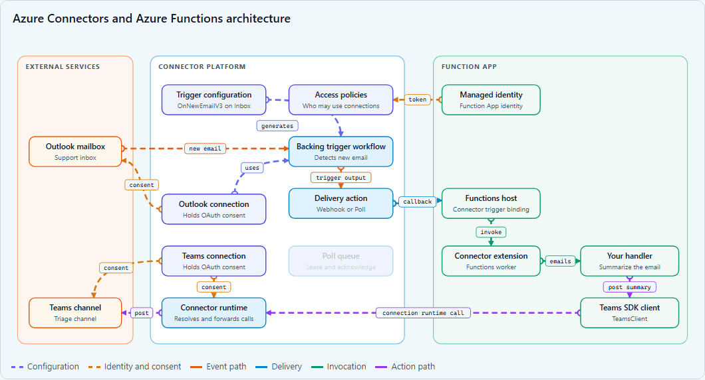
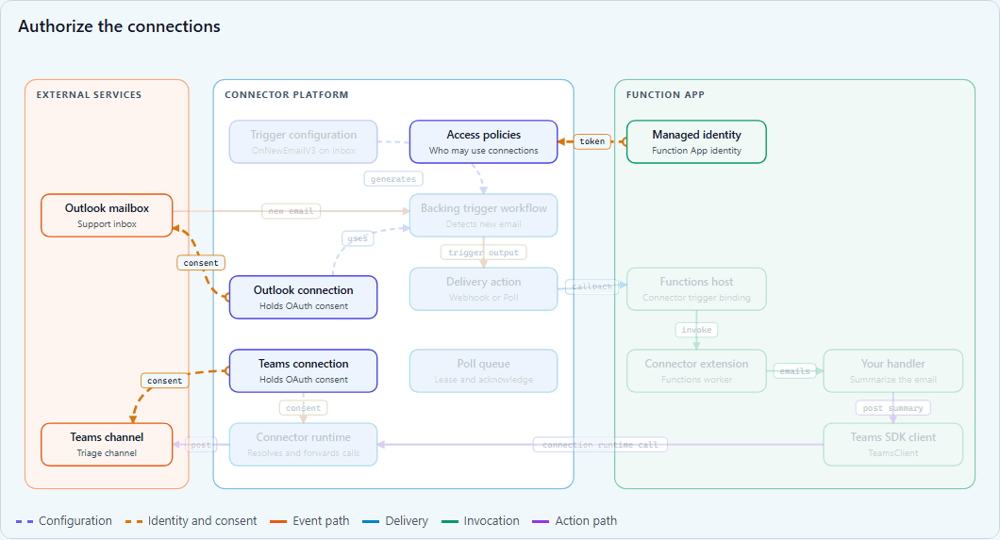
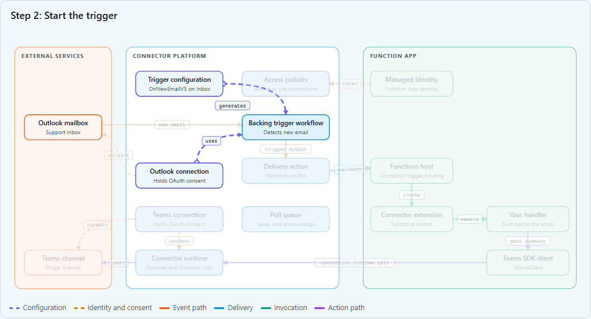
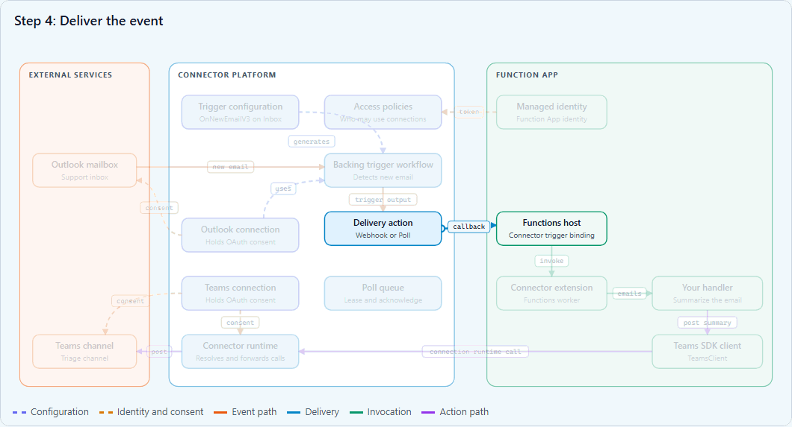
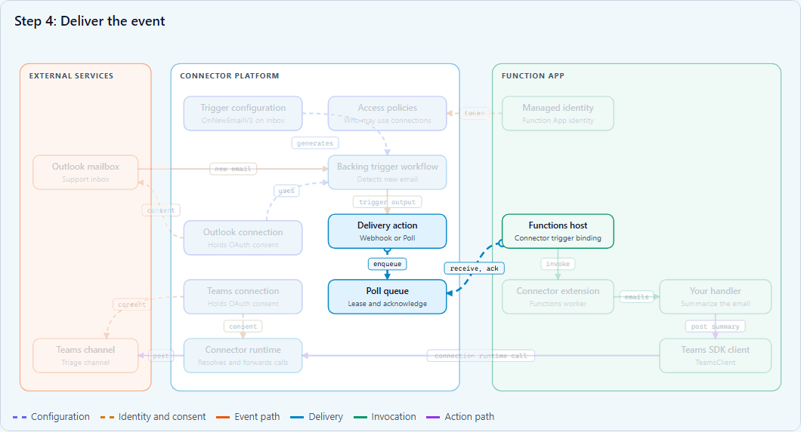
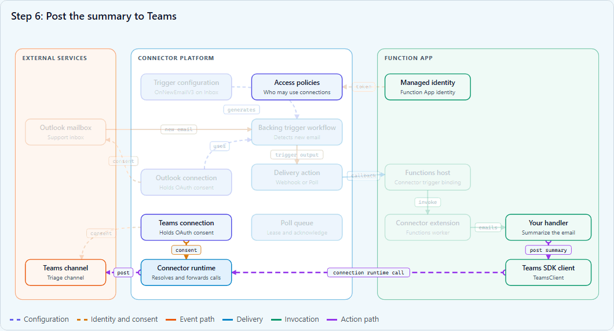

# Inside the architecture: How Connectors work with Azure Functions

Say you run a shared support inbox. Each time a customer writes in, you want a function to read the email, pick out the important parts, and post a summary in your team's Teams channel. The business logic might be twenty lines. The rest is authorization, change detection, event delivery, and a second set of permissions to post in Teams, and you rebuild most of it for every service you touch.

Azure Connectors and the Connector SDKs take that work on. The platform manages connections and authorization. The same app can react to events in one service and call operations in another. Webhook and poll delivery give you push or pull, so you can pick what fits your app. One SDK per language covers the Connector catalog with typed operations and payloads, VS Code tooling handles setup, and SDKs are available for .NET, Python, and Node.js from day one.

Underneath those promises are a handful of pieces we built and a few decisions about where each one stops. The support inbox runs through all of them. Follow that one email from Outlook to Teams, and you'll know exactly how to wire up the next hundred integrations yourself.

## Starting from what Azure already has

Azure already runs more than 1,600 managed Connectors to services like Salesforce, SAP, SQL Server etc. They power Azure Logic Apps and Power Automate, and API Hub hosts their connections, OAuth consent, and runtime. Logic Apps already knows how to run Connector triggers, whether the source sends notifications, accepts a webhook subscription, or has to be polled.

So we didn't write a second integration for each service. We built a new front door to the existing Connector runtime, one that application code can use directly, and added the glue Azure Functions needs on top. Most of the new work falls into four areas:

1. A control plane, the Connector Namespace, that exposes connections, access policies, and trigger configurations as Azure resources.
2. A runtime layer that proxies SDK calls into API Hub and turns trigger configurations into system-managed workflows with a delivery step at the end.
3. A Functions Connector extension, with host and worker pieces, that receives events by webhook or by polling and feeds the Functions scale controller.
4. One code generator that emits typed SDKs for .NET, Python, and Node.js from live Connector metadata, plus tooling that sets everything up.



The [interactive version of this diagram](./connectors-functions-architecture-explorer.html) steps through each stage and lets you switch between webhook and poll delivery.

## The control plane: Connector Namespace

A Connector Namespace is an Azure Resource Manager resource of type `Microsoft.Web/connectorGateways`. Under it sit three child resource types: connections, connection access policies, and trigger configurations. Because they're ARM resources, you can create them with Bicep, the CLI, or the VS Code tooling, and they get the usual Azure role-based access control and lifecycle.

A connection is the application-facing name for a backing API Hub connection, the same kind Logic Apps uses. The consent you grant for Outlook lives there. An access policy lists the Microsoft Entra identities, such as a Function App's managed identity, that may use a connection. That split means the identity that calls the connection and the account that consented to the mailbox are separate, and you can change one without touching the other.



A trigger configuration describes an event source. Its properties include the connection, the Connector operation (for the support inbox, `OnNewEmailV3`), the operation's parameters, optional trigger conditions and settings, and a delivery mode. For webhook delivery it carries the callback details; for poll delivery the service fills in the polling endpoints.

Each namespace also gets a stable host name, and a background job repairs its DNS record if it drifts.

## The action path: a proxy into API Hub

When your handler posts the summary to Teams, the generated SDK client sends an HTTPS request to the connection's runtime URL. On the platform side that URL maps to `api/connectorGateways/{gateway}/connections/{connection}/runtime`, followed by the operation's own path.

Behind that route, the runtime processor handles each request in four steps:

1. It resolves the application-facing connection to its backing API Hub connection and environment, in the namespace's scale unit.
2. It builds the API Hub runtime URL and checks that the requested path stays inside that connection, so a caller can't reach a different connection by rewriting the path.
3. It strips identity headers supplied by the caller and attaches a platform service token, plus headers that pass the caller's managed identity through.
4. It forwards the method, path, query, and body to API Hub, which runs the Connector operation against Teams.

The caller authenticates with a Microsoft Entra token for the API Hub audience. In the Node.js SDK the default scope is `https://apihub.azure.com/.default`, and the token comes from any Azure Identity `TokenCredential`, typically the Function App's managed identity.

The SDK side is thin on purpose. Generated clients extend a shared base class that holds the runtime URL and credential. A shared HTTP pipeline built on Azure Core adds the token, a user agent, tracing, and retries. Retries apply by default only to safe methods such as `GET` and `HEAD`, because retrying a `POST` that sends a message could send it twice. Paged operations follow `nextLink` values. When a continuation link points at a different host, as some Connector back ends return, the SDK reroutes its path and query through the connection's runtime URL, so paging stays behind the proxy. Failures surface as a `ConnectorError` that carries the Connector name, the operation, the status code, and the response body.

## The trigger path: system-managed workflows

When you create a trigger configuration, the trigger API validates the request, generates a Logic Apps workflow definition, creates the workflow directly in a platform-owned subscription under a generated name, and stores the workflow details alongside the trigger configuration. Updates rewrite the workflow, and deleting the trigger configuration removes the workflow, its poll queue, and its message history.



The workflow generator picks the right trigger shape for the operation's metadata: a notification subscription, a webhook subscription, or a recurring poll. It adds `splitOn` for operations that return batches, so each item becomes its own run unless the configuration opts out, and it applies any trigger conditions you set. The workflow ends with a Connector delivery action.

We generate a workflow per trigger configuration because Logic Apps already has years of hardening around subscription renewal, polling state, and trigger history, and every Connector trigger already runs on it. The workflow stays an implementation detail: customers work with the trigger configuration resource and never see or edit the workflow.

## Two ways to deliver an event

How the platform notices a new email and how the event reaches your function are separate problems. The backing workflow handles the first. The delivery action at the end of the workflow handles the second, and it supports two transports.

### Webhook delivery

For webhook delivery, which is the default, the delivery action makes an HTTPS call to the callback in the trigger configuration, using the workflow engine's HTTP retry policy. On the Function App side, the callback is the host's `/runtime/webhooks/connector` route, protected by a system key named `connector_extension`. A `functionName` query parameter selects the function. The host returns `202` when the invocation succeeds, `400` for a missing or invalid name, `404` for an unknown function, and `500` when the invocation fails.



### Poll delivery

For poll delivery, the delivery action writes the event to an Azure Storage queue owned by that trigger configuration and records it in a message history table. Storage queue messages are limited to 64 KiB, so when an event is larger the action queues a reference to the workflow run's output instead of the output itself.

The poll runtime API sits in front of the queue and has four operations: `receive`, `acknowledge`, `hasMessages`, and `approximateQueueDepth`. `receive` hands out events under a temporary lease with an opaque lock token. `acknowledge` deletes an event only when the message ID and a still-valid lock token match. If the lease expires first, the event becomes visible again. The reported depth is approximate and excludes leased messages.



Poll delivery means the Function App never exposes an inbound endpoint, and work can build up safely when the app is busy, scaled to zero, or running on a developer's laptop.

## Inside Azure Functions: the Connector extension

The Functions side has two layers. A host extension, written as a WebJobs extension, owns transport and scaling. A worker extension for each language turns payloads into typed objects for your handler.

### The host extension

The host extension registers a `connectorTrigger` binding. Each function picks webhook or poll delivery, and the binding starts the matching listener.

The poll listener runs a receive loop, with a few rules worth knowing:

- **Backoff:** an empty queue backs off with jitter, up to a configurable maximum interval; receive failures get their own capped backoff.
- **Auth:** the listener authenticates to the polling endpoint with the connection's credential, usually the Function App's managed identity.
- **Concurrency:** a function that takes one event at a time can run several invocations in parallel, up to `MaxConcurrentCalls`. A batched function processes one batch at a time per listener.
- **Acknowledgment:** an event is acknowledged only after its invocation succeeds; a failed invocation leaves it unacknowledged so it comes back when the lease expires.
- **Large outputs:** when an event holds a link to a large output, the listener downloads it, with a 100 MiB default cap.

Poll delivery also plugs into Azure Functions target-based scaling:

- The Connector trigger reports how much work is waiting by reading the queue's approximate depth through the same poll runtime API.
- Azure Functions does the scaling, aiming for `ceil(depth / target)` instances.
- The target is the function's pending-event threshold, or the per-instance concurrency that the platform supplies when it has one.
- Batch size and concurrency don't change that calculation.

Batching therefore happens in several places. The source trigger can return a collection, `splitOn` can split it into separate runs, and the poll listener can deliver several events to one invocation. The batch settings have the same meaning in every language:

| Setting | .NET isolated | Python | Node.js |
| --- | --- | --- | --- |
| Receive several events per invocation | `IsBatched = true` | `cardinality=func.Cardinality.MANY` | `cardinality: Cardinality.Many` |
| Maximum events per invocation | `MaxBatchSize` | `max_batch_size` | `maxBatchSize` |
| Concurrent single-event calls | `MaxConcurrentCalls` | `max_concurrent_calls` | `maxConcurrentCalls` |
| Pending events per instance, for scaling | `TargetPendingEventThreshold` | `target_pending_event_threshold` | `targetPendingEventThreshold` |

The batch size can be 1 through 32 and defaults to 1.

### The worker extensions

Because the host extension does the transport work, each language worker only has to bind payloads. The .NET isolated worker extension deserializes the payload into the type your function declares, such as a generated `Office365OnNewEmailTriggerPayload`, or into `ConnectorEvent<T>[]` when you also want each poll message ID. Python functions use the `connector_trigger` decorator from the `azure-functions` library. Other workers reach the same host extension through the Functions extension bundle and the `connectorTrigger` binding type.

The Node.js extension shows how thin this layer is. One generic wrapper registers the trigger and flattens every payload shape (a single item, a collection in `body.value`, or an array of poll envelopes) into one list of items, keeping the original in `rawPayload`. Each Connector's helper is then a few lines that add a friendly alias and borrow the item type from the generated SDK. This is the whole OneDrive for Business file:

```typescript
import { BlobMetadata } from "@azure/connectors/generated/OneDriveForBusinessExtensions";
import { OneDriveFileTriggerContext } from "../../types";
import { createConnectorTrigger } from "./createConnectorTrigger";

const registerFileTrigger = createConnectorTrigger<BlobMetadata, OneDriveFileTriggerContext>(
    (context) => ({ ...context, files: context.items }),
);

export const onNewFiles = registerFileTrigger;
export const onUpdatedFiles = registerFileTrigger;
```

`BlobMetadata` comes from the same generated module that the OneDrive client uses for actions, so a trigger payload and an action response share one type, defined once from the Connector's metadata.

### Calling out from the handler

After reading the email, the handler posts a summary to Teams. That call leaves the Function App through the same Connector platform, going the other way.

The handler calls a generated Teams client with typed input. The client holds the Teams connection's runtime URL and an Azure Identity credential, gets a Microsoft Entra token, usually for the Function App's managed identity, and sends the request. The Function App never holds a Teams token or secret.

The connection's access policies decide whether that identity may use the Teams connection, and the connection holds the OAuth consent for the account that posts. The Connector runtime resolves the connection, replaces the caller's identity headers with a platform token, and runs the operation against Teams.



This path doesn't depend on how the email arrived, so it works the same with webhook or poll delivery and with any Connector in the catalog. Idempotency is the handler's job. The SDK won't retry a failed post, but a redelivered event runs the whole invocation again, so the handler should check before posting the same summary twice.

## One generator, three SDKs

The SDKs are generated. A shared generator, `CodefulSdkGenerator`, reads live Connector Swagger definitions through Azure Resource Manager, cleans them up, and emits clients for C#, Python, and TypeScript. Each SDK repository records what produced it in a generation manifest: the generator commits, the metadata API version, and a hash of every Connector's Swagger input. That makes each regeneration traceable to a specific generator revision and a specific set of Connector definitions.

Besides action methods, the generator emits models for request and response bodies, typed trigger payloads and trigger operation constants, catalog constants that list the available Connectors, and support for paging and dynamic schemas. Each language then has a small handwritten runtime (the base client, the HTTP pipeline, errors, and paging) that the generated code builds on. Naming rules are kept consistent across languages, so the same Connector and operation have recognizable names whether you write C#, Python, or TypeScript.

For setup, the VS Code connection manager and the connection-setup skill create the namespace and connection through the ARM preview API, open the OAuth consent page and check that the connection reports `Connected`, add access policies for your developer identity or the Function App's managed identity, and write the runtime URLs into local or deployed app settings.

## Recap

When a customer writes in, the backing workflow detects the email through API Hub's existing Connector trigger. The delivery action then either calls the Function App's webhook or writes to a per-trigger storage queue that the host extension polls and scales on. The language worker binds the payload to a type that came from the same generator as the SDK, and the handler uses a generated Teams client whose calls go through the namespace's runtime proxy into API Hub.

Each piece reuses what was already there: the Logic Apps workflow engine for triggers, API Hub for connections and Connector runtime, the Functions extension model and scale controller for hosting, and Azure Identity for credentials. The new parts are the namespace resources that tie them together, the delivery step, the Functions extension, and the generator that keeps every language's types in step with the Connectors themselves.

## Resources

### Connectors SDKs

| Language | Repository |
| --- | --- |
| .NET | [Azure/Connectors-NET-SDK](https://github.com/Azure/Connectors-NET-SDK) |
| Python | [Azure/Connectors-Python-SDK](https://github.com/Azure/Connectors-Python-SDK) |
| Node.js | [Azure/Connectors-NodeJS-SDK](https://github.com/Azure/Connectors-NodeJS-SDK) |

### Azure Functions Connector extensions

| Component | Repository |
| --- | --- |
| Host extension and .NET isolated worker extension | [Azure/azure-functions-connector-extension](https://github.com/Azure/azure-functions-connector-extension) |
| Python worker extension | [azurefunctions-extensions-connectors](https://github.com/Azure/azure-functions-python-extensions/tree/dev/azurefunctions-extensions-connectors) |
| Node.js worker extension | [azure-functions-nodejs-extensions-connectors](https://github.com/Azure/azure-functions-nodejs-extensions/tree/main/azure-functions-nodejs-extensions-connectors) |

### Samples

| Sample | Repository |
| --- | --- |
| .NET email triage into Teams | [Azure-Samples/functions-connectors-net-e2e-email-users-teams](https://github.com/Azure-Samples/functions-connectors-net-e2e-email-users-teams) |
| .NET Connector samples | [Azure/Connectors-NET-samples](https://github.com/Azure/Connectors-NET-samples) |
| Python Connector samples | [Azure-Samples/functions-connectors-python](https://github.com/Azure-Samples/functions-connectors-python) |
| TypeScript Connector samples | [Azure-Samples/functions-connectors-typescript](https://github.com/Azure-Samples/functions-connectors-typescript) |

---

## References


| Architecture | Implementation reference |
| --- | --- |
| Webhook host extension | [Extension config provider](https://github.com/Azure/azure-functions-connector-extension/blob/main/src/Microsoft.Azure.Functions.Extensions.Connector/ConnectorExtensionConfigProvider.cs) and [extension roadmap](https://github.com/Azure/azure-functions-connector-extension/blob/main/README.md). |
| Poll listener and scaler | [Poll listener](https://github.com/Azure/azure-functions-connector-extension/blob/main/src/Microsoft.Azure.Functions.Extensions.Connector/Polling/ConnectorPollingListener.cs) and [target scaler](https://github.com/Azure/azure-functions-connector-extension/blob/main/src/Microsoft.Azure.Functions.Extensions.Connector/Polling/Scaling/ConnectorTargetScaler.cs). |
| Isolated worker converter | [Connector trigger converter](https://github.com/Azure/azure-functions-connector-extension/blob/main/src/Microsoft.Azure.Functions.Worker.Extensions.Connector/Converters/ConnectorTriggerConverter.cs). |
| Node.js worker extension | [Connector trigger wrapper](https://github.com/Azure/azure-functions-nodejs-extensions/blob/main/azure-functions-nodejs-extensions-connectors/src/connectors/connectorTrigger.ts) and [OneDrive for Business triggers](https://github.com/Azure/azure-functions-nodejs-extensions/blob/main/azure-functions-nodejs-extensions-connectors/src/connectors/oneDriveForBusinessTriggers.ts). |
| SDK runtime | [Connector client base](https://github.com/Azure/Connectors-NodeJS-SDK/blob/main/src/azureConnectors/clientBase.ts) and [Connector HTTP pipeline](https://github.com/Azure/Connectors-NodeJS-SDK/blob/main/src/azureConnectors/connectorHttpClient.ts). |
| Generation pipeline | [Generation guide](https://github.com/Azure/Connectors-NodeJS-SDK/blob/main/GENERATION.md) and [generation manifest](https://github.com/Azure/Connectors-NodeJS-SDK/blob/main/generation.manifest.json). |
| Setup tooling | [Connection setup skill](https://github.com/Azure/Connectors-NodeJS-SDK/blob/main/.github/skills/connection-setup/SKILL.md). |

> Note: The Connector platform internals described in the post (the resource model, runtime proxy, trigger workflows, delivery action, and poll runtime API) aren't in a public repository, so they have no links here.