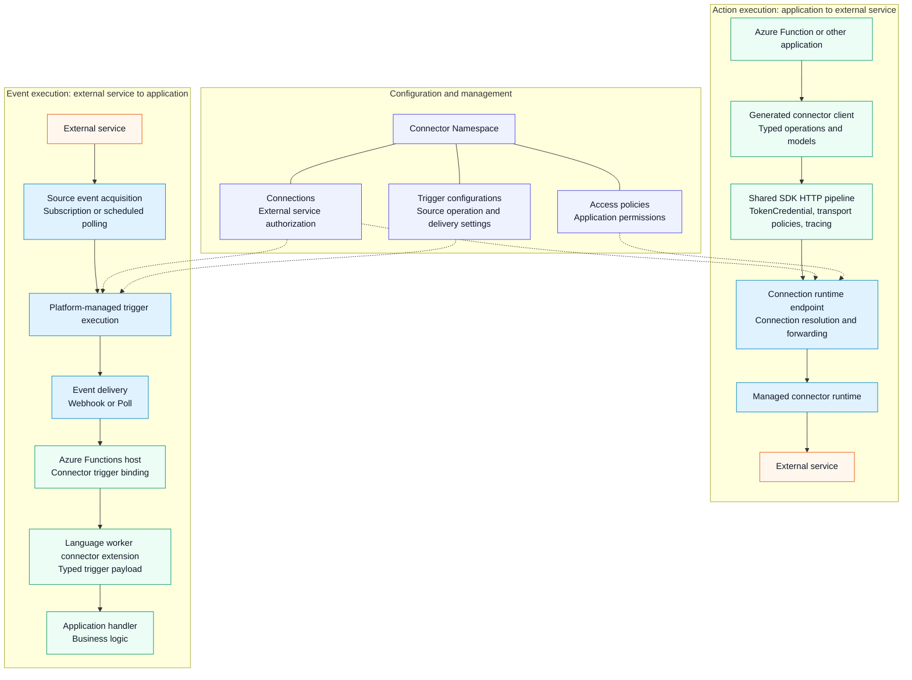
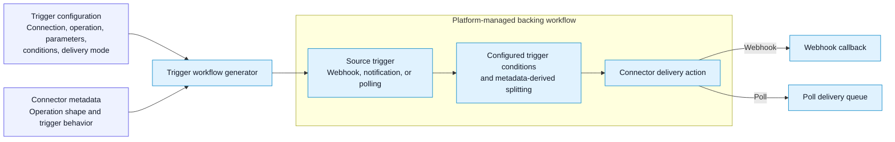
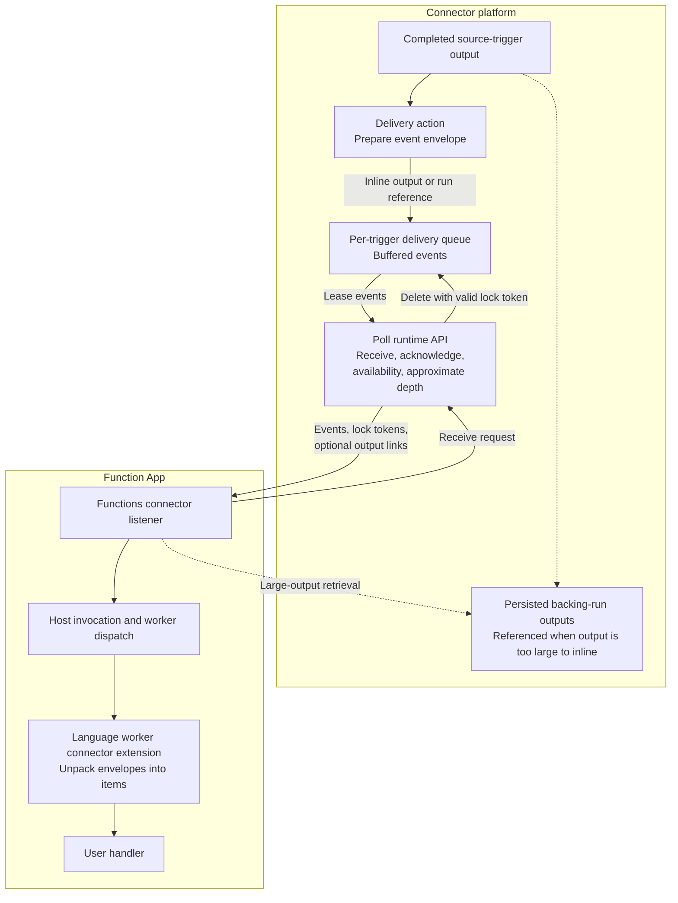

```mermaid
flowchart LR
    APP["Function App<br/>Managed identity"]
    ACCESS["Connector platform<br/>Application access policy"]
    CONNECTION["Authorized connection<br/>External service credentials or consent"]
    SERVICE["External service<br/>Service-specific permissions"]

    APP -->|"Application authentication"| ACCESS
    ACCESS -->|"Use permitted connection"| CONNECTION
    CONNECTION -->|"External service authorization"| SERVICE

    classDef application fill:#ecfdf5,stroke:#059669,color:#111827;
    classDef platform fill:#e0f2fe,stroke:#0284c7,color:#111827;
    classDef external fill:#fff7ed,stroke:#ea580c,color:#111827;
    class APP application;
    class ACCESS,CONNECTION platform;
    class SERVICE external;
```

# Inside the architecture: How connectors work with Azure Functions

> Working draft. Confirm release status and approval to publish backend implementation details before publishing. The source references and publication checklist at the end are author notes, not part of the finished post.

Say you run a shared support inbox. Each time a customer writes in, you want a function to read the email, pick out the important parts, and post a summary in your team's Teams channel. The business logic might be twenty lines.

The rest of the work takes longer. You need permission to read the mailbox, some way to notice new mail and get it to your function, and separate permission to post in Teams. You'll rebuild most of that the next time you connect to a different service.

Azure connectors and the connector SDKs handle that work for you. The platform manages connections and authorization: you grant consent and set access policies once, and your function never handles Outlook or Teams tokens. The same app can react to an email in one service and call operations in another without integration code of its own. You also choose how events reach you. Webhook delivery pushes them to your function, and Poll delivery lets the function pull them when it's ready. We kept both on purpose so you can use whichever fits your app.

Each language has one SDK for the connector catalog, which covers Microsoft 365, Azure services, and many SaaS and enterprise systems. Operations and payloads are typed, so IntelliSense and the compiler can check the fields you use. You set up connections and triggers from VS Code, the editor you already use for Functions, and SDKs are available for .NET, Python, and Node.js (JavaScript and TypeScript) from day one.

Below, we follow one email from the customer's Send button to the Teams channel.

## Architecture overview

Before any code runs, you configure a Connector Namespace. It holds your connections, access policies, and trigger configurations, which together define the services you connect to, who can use each connection, and which events you want.

At runtime, events travel from an external service to your function, and actions travel from your code to an external service. The support-inbox function uses both: the email arrives as an event, and the Teams post goes out as an action.



Solid arrows show runtime traffic, and dotted arrows show configuration that the runtime reads. The host, extension, and handler run inside your Function App as layers of one app.

The SDK gives you a typed API for each connector, and the managed connector runtime handles the integration with Outlook, Teams, or Salesforce. On the trigger side, the Functions helper registers your handler and cleans up the payload, while the platform talks to the source service.

## Step 1: Authorize the Outlook connection

Before the function can see the mailbox, you need an authorized Outlook connection and a trigger configuration that says what to watch.

In the Outlook sample, `azd up` handles most of the setup. It provisions the Function App, the Connector Namespace, and the access policies, opens the browser for Outlook consent, and sets up the new-email trigger on your Inbox. The Poll version of the trigger is created separately. Both the connection and the subscription exist before your handler runs, so your code never creates them.

Two separate permission checks are involved:



The Function App's managed identity lets it use the connection through the connector platform. The connection holds the Outlook consent, so the managed identity alone can't read anyone's mailbox. Connectors also differ in how they authorize. If your app authenticates to the platform and its calls still fail, check whether the connection needs consent.

## Step 2: Start the trigger

The event path begins with the trigger configuration. It names the connection, the operation (`OnNewEmailV3` in this example), its parameters, and the delivery mode. The platform uses it to generate a backing workflow that runs the connector trigger.



The conditions box groups trigger behavior and isn't a separate workflow step. The generator handles webhook, notification, and polling triggers, applies the trigger conditions you set, and uses connector metadata to split batches into individual items. The workflow's last action either calls your webhook or adds the output to a queue for your app to pull.

Connector triggers already run on Logic Apps workflow infrastructure, so we reused it for Functions instead of building a second event engine. You don't write or manage this workflow. You work with the connection, the trigger configuration, and your handler.

When a customer sends an email, the workflow detects it. How the platform detected the email and how the email reaches your function are separate questions.

## Step 3: Separate source polling from Poll delivery

The word "polling" appears on both sides of the platform with different meanings, which makes the two easy to mix up.

Source polling is how the platform finds out about a change. Some services send notifications through a subscription, and others are checked on a schedule. Poll delivery is how your function receives events the platform has already captured.

You can combine them. The platform might check a mailbox on a schedule and push each new email to your function by webhook, or a service notification might wait in a Poll queue until your function picks it up. The connector handles detection, and you pick the delivery mode. Check which combinations your operation supports, because some aren't available for every operation.

## Step 4: Choose webhook or Poll delivery

The right choice depends on your network setup and how you want to process work.

### Webhook delivery

With webhook delivery, the platform sends each event to a callback on your Function App, which passes it to your handler. Use it when your app already has an endpoint the platform can reach.

Starting the Functions host on your laptop doesn't make it reachable; the trigger configuration has to point at an endpoint the platform can call. Deliveries can also fail or arrive twice, so handle both cases.

### Poll delivery

With Poll delivery, the platform writes trigger output to a queue tied to the trigger configuration, and your Function App pulls from that queue. You don't expose a public callback, which helps with local development and locked-down networks, and your app can work through events at its own pace.



Receiving and removing are separate operations in the queue protocol. A receive call returns events under a temporary lease, and an acknowledge call deletes them using the message IDs and lock tokens from the receive. Your app can also check whether events are waiting and get an approximate queue depth.

The Functions host decides when to acknowledge relative to your handler finishing, and that timing may change between releases.

Events stay in the queue until your app receives them, within the service's retention limits. If a lease expires before acknowledgement, the event comes back, so make side effects idempotent where you can.

Large outputs, such as an email with a big attachment, aren't stored in the queue. The platform keeps the run output and queues a reference, and your function follows the link to fetch the content.

## Step 5: Run the handler

In the Function App, the host's connector binding turns each delivery into a function invocation. Each language worker has a connector extension that passes the payload to your handler as typed objects: `Microsoft.Azure.Functions.Worker.Extensions.Connector` for the .NET isolated worker, `azurefunctions-extensions-connectors` for Python, and `@azure/functions-extensions-connectors` for Node.js.

| Layer | What it does |
| --- | --- |
| Connector platform | Holds connections, runs source triggers, delivers events. |
| Functions host and connector binding | Listens for events and invokes your function. |
| Language worker connector extension | Turns payloads into typed objects and provides registration helpers. |
| Your handler | Validates data, transforms it, and does the actual work. |

The handler code looks a little different in each language. In .NET you bind to a typed payload such as `Office365OnNewEmailTriggerPayload`. In Python your function receives a list of typed messages. In Node.js the extension collects single items, collections, and Poll envelopes into `context.emails` and keeps the original envelopes in `context.rawPayload`.

These new-email handlers are adapted from the samples:

```csharp
[Function("OnNewEmail")]
public IActionResult OnNewEmail(
    [ConnectorTrigger()] Office365OnNewEmailTriggerPayload payload)
{
    var emails = payload?.Body?.Value;
    if (emails is null)
    {
        return new OkResult();
    }

    foreach (var email in emails)
    {
        _logger.LogInformation("Subject: {Subject}, From: {From}", email.Subject, email.From);
    }

    return new OkResult();
}
```

```python
import logging
from typing import List

import azure.functions as func
import azurefunctions.extensions.connectors.office365 as office365

app = func.FunctionApp()


@app.function_name(name="OnNewEmail")
@app.connector_trigger(arg_name="emails")
def on_new_email(emails: List[office365.ClientReceiveMessage]) -> None:
    for email in emails:
        logging.info(f"Subject: '{email.subject}', From: '{email.from_}'.")
```

```typescript
import { InvocationContext } from "@azure/functions";
import { connectors, EmailTriggerContext } from "@azure/functions-extensions-connectors";

connectors.office365.onNewEmail("OnNewEmail", {
    handler: async (context: EmailTriggerContext, invocationContext: InvocationContext) => {
        for (const email of context.emails) {
            invocationContext.log(`Subject: '${email.subject}', From: '${email.from}'.`);
        }

        return context.rawPayload;
    },
});
```

Each registration names the function and supplies the handler. Connection authorization and trigger setup happened in step 1. The samples log email metadata, so run them against a test account.

The types help in the editor, but nothing checks them at runtime. Validate any field your logic depends on, especially in dynamic records.

### Batching and scaling

Batching can happen in four places. The source trigger can return a collection, and the platform can split that collection into separate runs based on metadata and configuration. Poll delivery can then return several events at once, which the extension passes to a single handler call.

The TypeScript Poll sample sets the batch options explicitly:

```typescript
import { Cardinality, DeliveryMode, InvocationContext } from "@azure/functions";
import { connectors, EmailTriggerContext } from "@azure/functions-extensions-connectors";

connectors.office365.onNewEmail("OnNewEmailPoll", {
    deliveryMode: DeliveryMode.Poll,
    connection: "ConnectorNamespace",
    triggerConfigName: "%OnNewEmailPollTriggerConfigName%",
    cardinality: Cardinality.Many,
    maxBatchSize: 4,
    targetPendingEventThreshold: 16,
    handler: async (context: EmailTriggerContext, invocationContext: InvocationContext) => {
        for (const email of context.emails) {
            invocationContext.log(`Subject: '${email.subject}', From: '${email.from}'.`);
        }

        return context.rawPayload;
    },
});
```

The event count and the email count can differ. Here `maxBatchSize: 4` limits each invocation to four Poll events, but one event can hold several emails, so `context.emails` can have more than four entries. This sample is disabled by default.

Cardinality and batch size control how events are grouped into an invocation. `MaxConcurrentCalls` limits concurrent calls when events arrive one at a time; the host ignores it for batched bindings like this one. The pending-event target is an input to scaling decisions.

Raising every setting won't necessarily increase throughput. The external service may throttle you, and your handler may do slow or non-repeatable work, so measure throughput across the whole pipeline, from receiving the event to finishing its side effects.

## Step 6: Post the summary to Teams

Once the handler has pulled the important details out of the email, it posts them to Teams. This call uses the action path from the overview diagram, which is independent of how the email arrived.

The .NET email triage sample does this. For each email its classifier marks as important, it calls `PostMessageToConversationAsync` on a `TeamsClient` to post a triage card, then uses an `Office365Client` to flag the source email in Outlook. The Python and Node.js SDKs generate the same kind of client for each connector.

Under each client, the SDK builds the request, gets a token from an Azure Identity credential, applies retries and other HTTP policies, and reports errors. The Connector Namespace resolves your connection and passes the call to the managed connector runtime, which calls Teams.

Other generated clients follow the same pattern; you could use the SharePoint Online client to save the attachment. The clients also work outside Azure Functions, in any .NET, Python, or Node.js app.

Retries don't make every call safe to repeat. If the same summary is posted twice, your team sees it twice, so know which operations your app can retry safely.

## Recap

The connector detected the email in the mailbox, the platform delivered it by webhook or Poll, Functions invoked your handler, and an SDK client posted the summary to Teams. Your code ran only in the last two steps. The platform owns connections, detection, and delivery; Functions hosts your code; the SDKs and language extensions provide typed APIs; and your code owns validation, side effects, and idempotency.

To try it, deploy one of the samples with `azd up` using a test account and send that account an email. The TypeScript and Python Outlook samples log each new email, and the .NET email triage sample also posts to Teams.

---

## Author notes: source references

These references describe the inspected local source, not a guarantee that every detail has shipped in a public release. The sibling-repository links assume the repositories share a parent folder.

| Architecture | Implementation reference |
| --- | --- |
| Connector action runtime proxy | [Connection runtime processor](../AzureUX-BPM/src/flow/Roles/Flow.Web.Cloud.NetCore/RequestProcessors/ConnectorGatewayConnectionRuntimeProcessor.cs). |
| Trigger setup and Poll protocol | [Trigger configuration engine](../AzureUX-BPM/src/flow/Roles/Flow.Web.Cloud.New/ApiEngines/AIGateways/AIGatewayTriggerConfigApiEngine.cs). |
| Generated trigger execution | [Trigger workflow generator](../AzureUX-BPM/src/flow/Roles/Flow.Web.Cloud.New/ApiEngines/AIGateways/AIGatewayTriggerConfigWorkflowGenerator.cs). |
| Push versus queue delivery | [Connector delivery action](../AzureUX-BPM/src/flow/Roles/Flow.Worker.Common/Jobs/Actions/ConnectorGatewayActionJob.cs). |
| Shared action client | [Connector client base](../Connectors-NodeJS-SDK/src/azureConnectors/clientBase.ts). |
| SDK transport and authentication | [Connector HTTP pipeline](../Connectors-NodeJS-SDK/src/azureConnectors/connectorHttpClient.ts). |
| Functions registration and normalization | [Node.js connector trigger wrapper](azure-functions-nodejs-extensions-connectors/src/connectors/connectorTrigger.ts). |
| Functions helper options | [Connector extension guide](azure-functions-nodejs-extensions-connectors/README.md). |
| Batched handler | [Outlook polling function](../../../functions-connectors-typescript/office365App/src/functions/onNewEmailPoll.ts). |
| Deployment and identity setup | [Outlook sample deployment](../../../functions-connectors-typescript/office365App/README.md). |
| TypeScript new-email handler | [Outlook webhook function](../../../functions-connectors-typescript/office365App/src/functions/onNewEmail.ts). |
| Python new-email handler | [Python Outlook sample](../../../functions-connectors-python/office365App/function_app.py). |
| .NET trigger and Teams action | [.NET email triage function](../../../functions-connectors-net-e2e-email-users-teams/function-app/ProcessEmail.cs). |

## Author notes: publication checklist

- Confirm approval to disclose backing workflows, queue behavior, and large-output references.
- Pin the package versions used in any accompanying example. The SDK README describes 1.0.0 GA, while the inspected samples use preview packages.
- Confirm supported connector operations and delivery combinations for the demonstrated release.
- The intro states day-one support for .NET, Python, and Node.js, VS Code tooling, and a single-library catalog without qualification. Confirm release status, feature parity, and the connectors included in each package before publishing.
- Verify exact host acknowledgement timing, failure handling, and scaling behavior against the matching host implementation before adding stronger claims.
- Do not promise exactly-once processing, global ordering, a latency target, or unlimited buffering.
- Run one end-to-end example using test data and capture the resulting function invocation.
- The only Poll and batching example is TypeScript, because the inspected Python and .NET samples use webhook delivery. Confirm Poll delivery and batch options for the Python and .NET extensions, and add matching examples if they exist.
- The .NET and Python snippets are trimmed from the samples. Build and run each snippet before publishing.
- Preview the Mermaid diagrams in a renderer that supports Mermaid before publishing. Export them as images if the blog platform does not render Mermaid.
- Remove these author notes and replace internal source links with approved public references.
